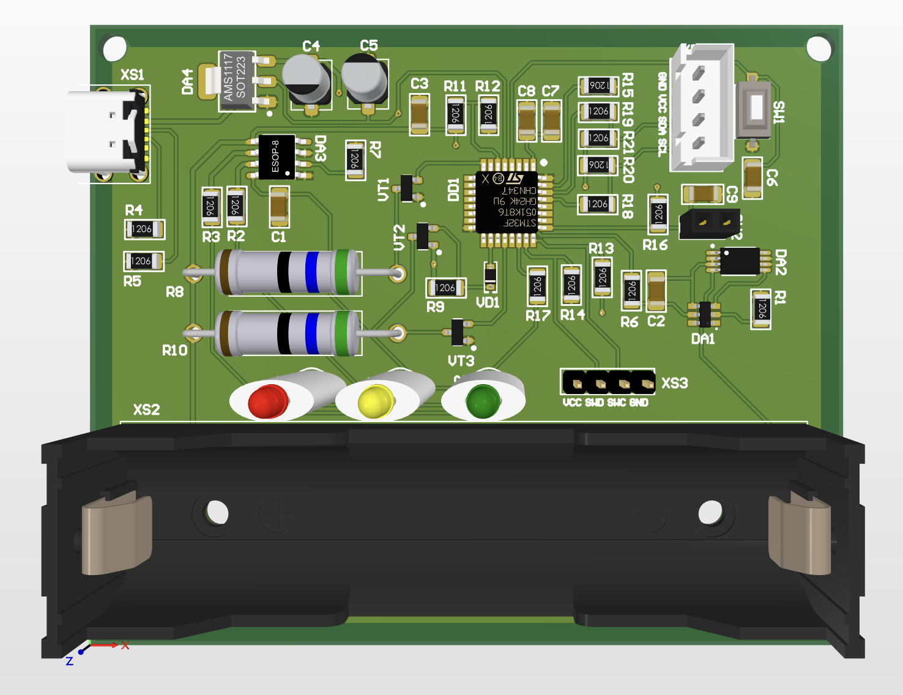
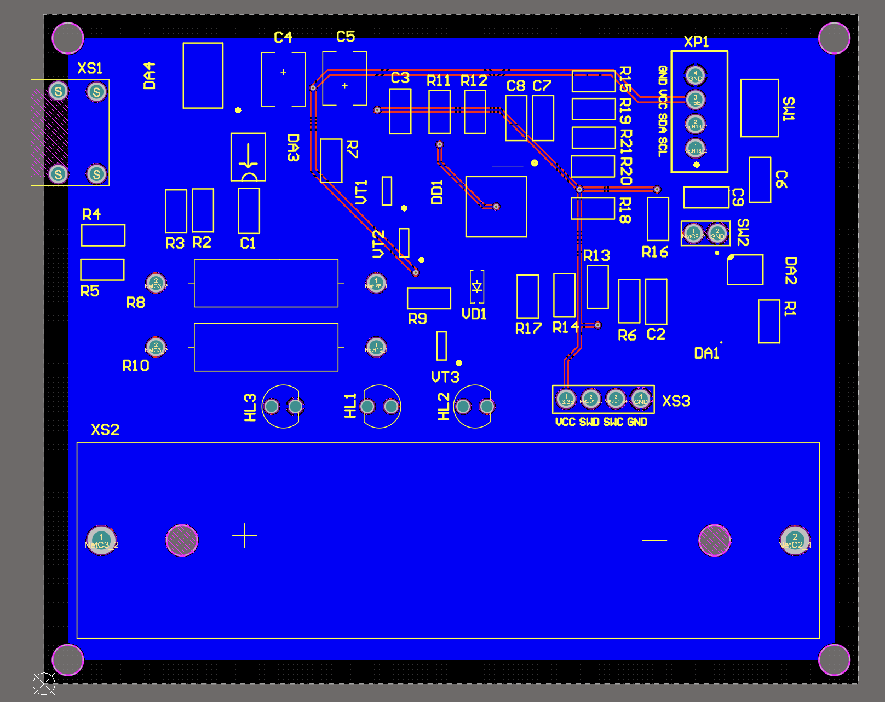
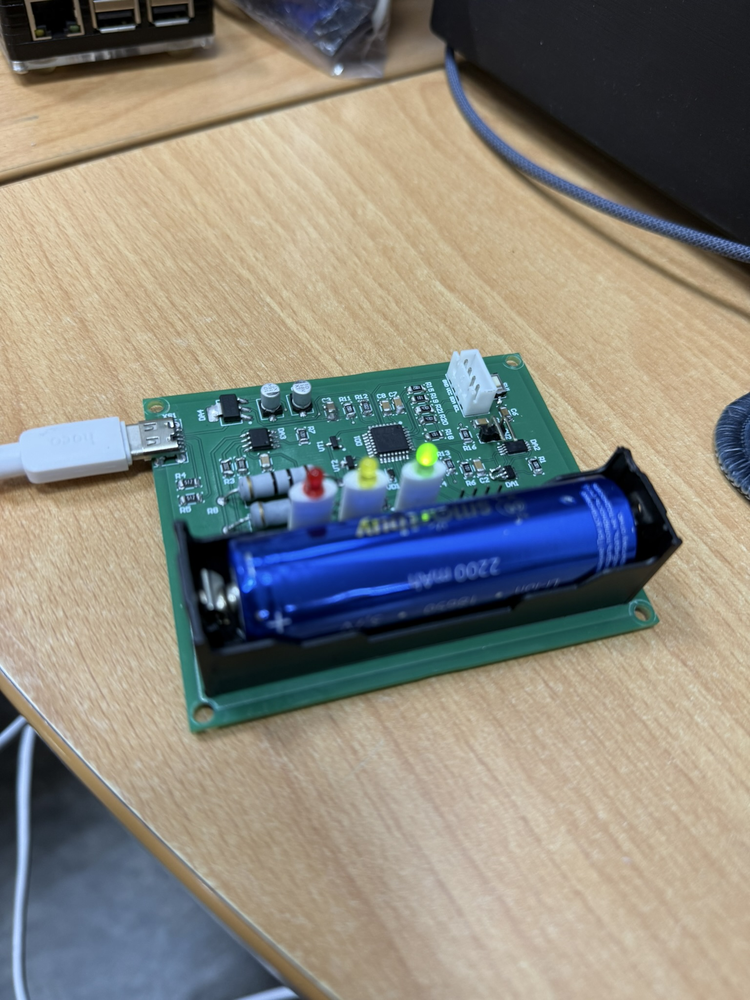

# Li-ion 18650 Capacity Meter

A single-channel capacity meter and charger for **18650 Li-ion cells**, built around the **STM32F051K8T6** microcontroller. The device measures capacity by discharging the cell through switched resistive loads and integrating the calculated current over time. A **16 × 2 I²C LCD** displays the battery voltage, discharge current, accumulated capacity, and elapsed time.

The project includes a custom PCB, an enclosure, an assembled prototype, and Russian engineering documentation. Firmware source files are not included.

## Block Diagram

The external 5 V supply powers the display, charger, and 3.3 V regulator. The microcontroller reads the battery voltage, switches the discharge loads, controls charging, and updates the display and indicators. A reset button and a separate mode button provide user control. The SWD connector provides access for programming and debugging.

## Schematic

The circuit contains the following functional sections:

- **Power input:** USB Type-C connector XS1 and AMS1117-3.3 regulator DA4 provide the 5 V and 3.3 V rails.
- **Charging and protection:** TP4056 DA3 charges the cell; DW01A DA1 and FS8205A DA2 form the battery protection circuit.
- **Discharge loads:** MOSFETs VT1 and VT3 switch the 10 Ω and 20 Ω power resistors R8 and R10. The STM32 measures cell voltage through divider R11/R12 and calculates the current from the active load resistance.
- **Control and indication:** STM32F051K8T6 DD1 controls the operating sequence. XP1 connects the LCD, XS3 provides SWD access, and SW2 connects the external mode button.

Capacity is accumulated as **Q = Σ(I × Δt) / 3600**, with current in mA and time in seconds, giving the result in mAh. Energy is accumulated from voltage and current over the same intervals.

## PCB

### 3D View

### Top Layer

### Bottom Layer

The PCB measures **85 × 70 mm** and uses **two copper layers** with ground pours. The report specifies FR-4 with a **1.5 mm dielectric thickness** and **35 µm starting copper foil**. Most passive components use the 1206 package; the two discharge resistors, LEDs, battery holder, and headers use through-hole mounting. The battery holder is integrated into the board layout.

## Assembled Device

### PCB Prototype

### Enclosure Design

The enclosure has a base and removable lid, with openings for the battery, LCD, indicators, USB connector, and control button. The mechanical design specifies **FDM printing in ABS** and overall dimensions of **104.68 × 82 × 35.89 mm**. The PCB and display are secured with M3 fasteners and threaded inserts.

### Built Device

The photograph shows the assembled unit in charging mode, with the cell voltage and elapsed time on the LCD.

### Operation

1. Insert the 18650 cell with the correct polarity and connect a **5 V USB supply**.
2. Use the external mode button connected to SW2 to select measurement or charging.
3. In measurement mode, both load branches are initially enabled. At **3.30 V**, the 10 Ω branch is disconnected and discharge continues through the 20 Ω branch.
4. Measurement ends after three consecutive voltage readings at or below **3.0 V**. Both loads are disconnected, and the final screens show capacity, elapsed time, average current, and energy.
5. In charging mode, the discharge loads remain off and TP4056 charges the cell using its CC/CV sequence. The yellow indicator HL1 shows charging; the green indicator HL2 shows charge completion. Red indicator HL3 identifies measurement mode.

### Prototype Results

The report records the following results for one test cell labelled **800 mAh**:

| Parameter | Recorded result |
| --- | ---: |
| Measured capacity | 717.8 mAh |
| Discharge duration | 1 h 21 min 16 s |
| Average discharge current | 529 mA |
| Measured energy | 2662.7 mWh |
| End-of-discharge voltage shown by the device | 3.01 V |
| End-of-charge voltage | 4.19 V on the device / 4.20 V on the multimeter |
| Charging duration | 1 h 10 min |

These are results for the tested sample. The difference from the cell's labelled capacity is not a calibration measurement of the instrument. The report also notes a voltage-reading offset during discharge, which affects calculated current and capacity.

## Bill of Materials

The PCB BOM below is compiled from the schematic and report. Blank manufacturer or part-number fields are left for completion; the CSV uses the same entries.

| Designators | Qty | Value / Part | Description | Manufacturer | Part Number | Package |
| --- | ---: | --- | --- | --- | --- | --- |
| C1, C2, C6–C9 | 6 | 0.1 µF | Ceramic capacitor, 100 V, ±10% | Murata | — | 1206 |
| C3 | 1 | 10 µF | Ceramic capacitor, 10 V, ±10% | Murata | — | 1206 |
| C4, C5 | 2 | 10 µF | Electrolytic capacitor, 16 V, ±20% | JB Capacitors | JCK1C100M040054 | SMD, Ø4 mm |
| DA1 | 1 | DW01A | Single-cell Li-ion protection controller | — | DW01A | SOT-23-6 |
| DA2 | 1 | FS8205A | Dual N-channel MOSFET | Fortune Semiconductor | FS8205A | TSSOP-8 |
| DA3 | 1 | TP4056 | Single-cell Li-ion charge controller | UMW | TP4056 | ESOP-8 |
| DA4 | 1 | AMS1117-3.3 | Linear voltage regulator, 3.3 V | UMW | AMS1117-3.3 | SOT-223 |
| DD1 | 1 | STM32F051K8T6 | 32-bit Arm Cortex-M0 microcontroller | STMicroelectronics | STM32F051K8T6 | LQFP-32 |
| HL1 | 1 | Yellow | Indicator LED | G-nor Electronics | GNL-3014YD | THT, Ø3 mm |
| HL2 | 1 | Green | Indicator LED | G-nor Electronics | GNL-3014GD | THT, Ø3 mm |
| HL3 | 1 | Red | Indicator LED | G-nor Electronics | GNL-3014HD | THT, Ø3 mm |
| R1 | 1 | 1 kΩ | Chip resistor, 0.25 W, ±1% | Yageo | — | 1206 |
| R2, R3 | 2 | 200 Ω | Chip resistor, 0.25 W, ±1% | Yageo | — | 1206 |
| R4, R5 | 2 | 5.1 kΩ | Chip resistor, 0.25 W, ±1% | Yageo | — | 1206 |
| R6, R17–R19 | 4 | 100 Ω | Chip resistor, 0.25 W, ±1% | Yageo | — | 1206 |
| R7 | 1 | 1.2 kΩ | Chip resistor, 0.25 W, ±1% | Yageo | — | 1206 |
| R9 | 1 | 510 Ω | Chip resistor, 0.25 W, ±1% | Yageo | — | 1206 |
| R11–R16 | 6 | 10 kΩ | Chip resistor, 0.25 W, ±1% | Yageo | — | 1206 |
| R20, R21 | 2 | 4.7 kΩ | Chip resistor, 0.25 W, ±1% | Yageo | — | 1206 |
| R8 | 1 | 10 Ω | Power resistor, 2 W, ±5% | — | — | Axial, THT |
| R10 | 1 | 20 Ω | Power resistor, 2 W, ±5% | — | — | Axial, THT |
| SW1 | 1 | IT-1181A | Reset tactile switch | RUICHI | IT-1181A | SMD |
| SW2 | 1 | 2-pin | Header for the external control button, 2.54 mm pitch | Connfly | DS1022-1*2RDF11-B | Right-angle, THT |
| VD1 | 1 | BZT52C3V3S | Zener diode, 3.3 V, 0.2 W | — | BZT52C3V3S | SOD-323 |
| VT1, VT3 | 2 | IRLML2502 | N-channel MOSFET, 20 V | — | IRLML2502 | SOT-23 |
| VT2 | 1 | IRLML6402 | P-channel MOSFET, −20 V | — | IRLML6402 | SOT-23 |
| XP1 | 1 | 4-pin | Display connector, 2.5 mm pitch | JST | B4B-XH-A(LF)(SN) | THT |
| XS1 | 1 | USB Type-C | Power input receptacle, 6 contacts | RUICHI | USB3.1 TYPE-C 06PF-027 | SMD / THT |
| XS2 | 1 | 18650 | Single-cell battery holder | KLS | KLS5-18650-D | THT |
| XS3 | 1 | 4-pin | SWD programming connector, 2.54 mm pitch | Connfly | DS1021-1*4SF11-B | THT |

[Download the BOM summary CSV](docs/li-ion-18650-capacity-meter_BOM-summary.csv)

The complete device additionally uses an **LCD1602 display with an I²C interface**, an external **PBS-33B-B button**, the printed enclosure, wiring, LED spacers, and M3 fasteners. These items are separate from the PCB BOM.

## Additional Notes

- Discharge current is calculated from measured voltage and nominal load resistance. Resistor tolerance and voltage calibration affect the capacity result.
- The 10 Ω and 20 Ω loads are rated at 2 W each and dissipate heat during measurement. The enclosure includes the battery opening shown in the mechanical design.
- USB Type-C is used for power input. The display and controls allow operation without a computer.

## Documentation (Russian)

[Расчётно-пояснительная записка и приложения](docs/original-ru/li-ion-18650-capacity-meter_report.docx)

| Документ | Приложение в РПЗ |
| --- | --- |
| Схема электрическая структурная (Э1) | А |
| Схема электрическая принципиальная (Э3) | Б |
| Перечень элементов (ПЭ3) | В |
| Алгоритм работы устройства | Г |
| Чертёж печатной платы | Д |
| Сборочный чертёж электронной ячейки | Е |
| Спецификация электронной ячейки | Ж |
| Сборочный чертёж устройства | И |
| Спецификация устройства | К |
| Схема сборки электронной ячейки | Л |
| Схема сборки устройства | М |
| 3D технологический процесс сборки | Н |
| Плакат демонстрационный | П |
